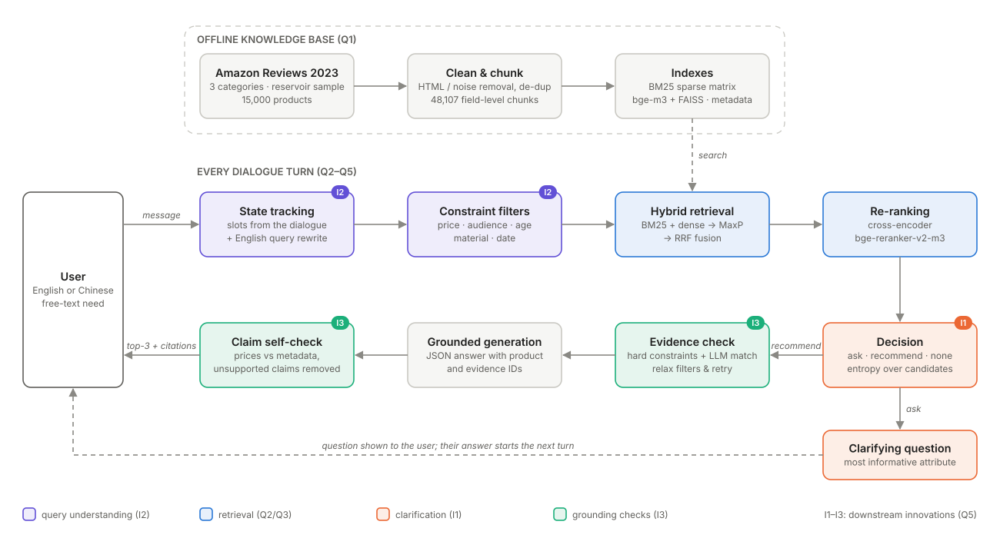
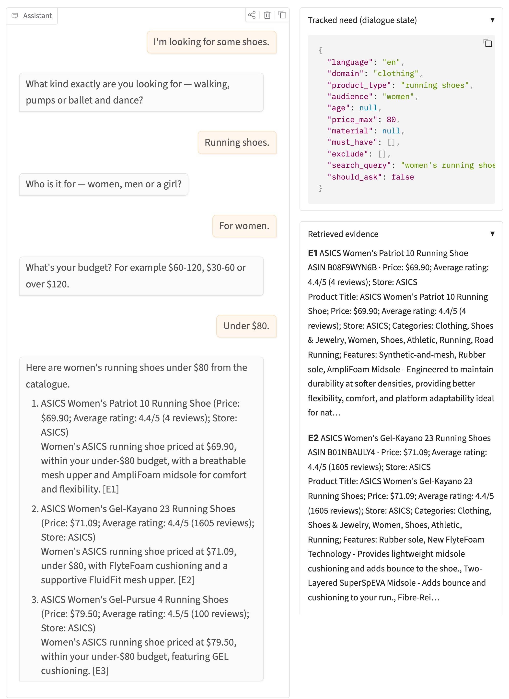
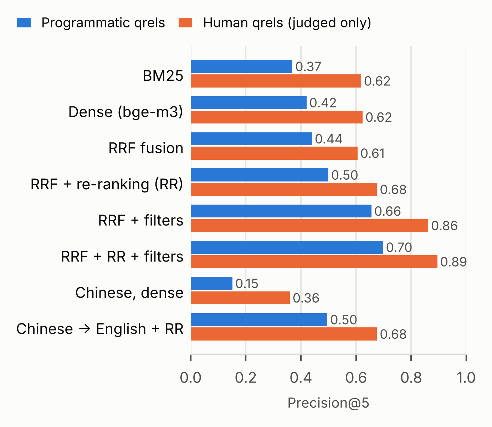
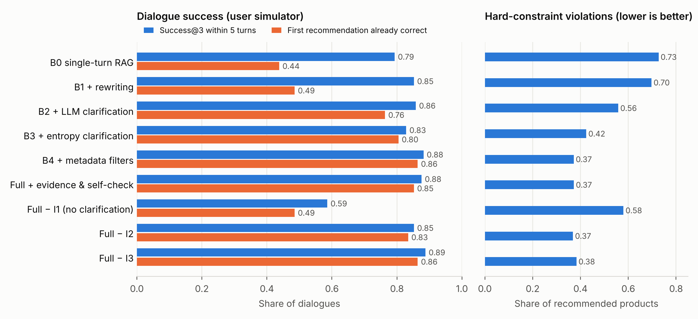

# AI6127 Group Assignment — Conversational RAG Product Recommender

**Group:** 20  
**Members (name / matriculation no.):** TBD  
**Knowledge base, queries, results and evaluation data (zip):** TBD (Google Drive / OneDrive link)  
**Source code and README (zip):** TBD (link) — repository: https://github.com/lsy640/AI6127-RAG

---

## 0. System overview

We build a **multi-turn, retrieval-augmented shopping assistant** over Amazon product metadata. A user describes what they want in free text (English or Chinese). Because a single message rarely contains every requirement ("recommend me some shoes" says nothing about gender, use, size or budget), the agent decides at every turn whether it has enough information to recommend. If not, it **asks a targeted clarifying question**. When it does recommend, every claim is grounded in retrieved product evidence with citations.

Per-turn pipeline:

1. **Dialogue state tracking** — the LLM updates a structured need `{product_type, audience, age, price_max, material, must_have, exclude}` from the conversation.
2. **Query rewriting** — history + current message → one self-contained English search query (also handles Chinese input).
3. **Retrieval** — field-level chunks; BM25 + bge-m3 dense retrieval → parent-document merge → RRF fusion → metadata filters (price, audience, age, material, date) → cross-encoder re-ranking.
4. **Decision** — *recommend*, *ask* (choose the attribute that best splits the current candidates), or *report that nothing matches*.
5. **Evidence check** — verify that candidates satisfy the hard constraints; relax filters and retrieve again if needed.
6. **Grounded generation + self-check** — JSON answer with product IDs and evidence IDs; unsupported claims are flagged and removed.

*Figure 1. System architecture. Top: offline knowledge base; middle and bottom: the pipeline run at every dialogue turn. Colours mark query understanding (I2), retrieval (Q2/Q3), clarification (I1) and grounding checks (I3).*

---

## Question 1 — Knowledge base

### 1.1 Gathering, cleaning, chunking and storage

| Step | What we did |
|---|---|
| Source | McAuley Lab *Amazon Reviews 2023* product metadata, three categories: Clothing, Shoes & Jewelry (7,218,481 products), Home & Kitchen (3,735,584), Toys & Games (890,874). Streamed from the public `.jsonl.gz` dumps with `requests` + `gzip`; nothing is stored on disk except the sample. |
| Filtering | Keep only products whose title, features, description, categories, details, price, average rating, rating count and store are all non-empty (re-checked after cleaning). Valid products: 835,390 (11.6%), 749,624 (20.1%) and 268,771 (30.2%). |
| Sampling | **Reservoir sampling over the entire file** of each category (seed 42), 5,000 products per category. A naive "first N valid products" sample is biased: the first 30k Clothing products have a 25% validity rate versus 11.6% overall. |
| Cleaning | HTML tags/entities removed (174 / 15 fields), emoji and decorative symbols removed (7,186 fields); noisy specification keys dropped (Best Sellers Rank in 8,710 products, Item model number 8,451, Is Discontinued 5,226, …); Python dict/list values no longer serialised into text; duplicate bullets removed; Manufacturer dropped when equal to Brand. |
| De-duplication | By `parent_asin` and by normalised title across categories (10 duplicates removed). |
| Document format | `text` holds only semantic fields (title, categories, features, description, specs). Price, rating, review count, store, main category and first-available date are kept in structured `meta`, used for filtering, evidence headers and display, so they do not dilute embeddings. |
| Chunking | **Field-level chunks**, each prefixed with the product title: `overview` = categories + features (≤200 words per chunk), `description` = 200-word windows with 40-word overlap, `specs` = specifications. Retrieval runs on chunks; scores are merged to products (parent-document retrieval); generation uses the full product text. |
| Storage | `kb.json` (products), `chunks.json` (retrieval units), `kb_pyserini.jsonl` (Pyserini format), FAISS `IndexFlatIP` indexes with a JSON sidecar recording model, unit, prompt setting, precision and the id order. |

### 1.2 Application and sample inputs

Task: **conversational product recommendation with clarification**. Users state a need, possibly vague and in English or Chinese; the system asks follow-up questions until the need is specific enough, then recommends products with grounded reasons, prices and ratings.

Sample interactions:

- "I need some shoes." → *"Are these for men or women, and mainly for running, work or hiking?"* → "Women's, for running, under $80." → recommendations.
- "推荐一个适合 3 岁孩子的玩具" ("recommend a toy for a 3-year-old") → *"Any preference: building blocks, puzzles or pretend play? What is your budget?"*
- "A non-stick frying pan that works on induction, below $50." → recommended directly (need fully specified).

### 1.3 Corpus statistics (`data/corpus_stats.json`)

| Metric | Value |
|---|---|
| Documents (products) | 15,000 (5,000 per category) |
| Chunks | 48,107 (overview 16,483 / description 16,609 / specs 15,015) |
| Words (whitespace tokens, product text) | 3,589,422 |
| Types (unique lower-cased alphanumeric tokens) | 60,141 (212,432 with raw whitespace tokenisation) |
| Words per product | mean 239, median 203, p95 508, max 2,040 |
| Words per chunk | mean 88, max 421 (≤ 817 bge-m3 tokens, so no truncation) |

---

## Question 2 — Retrieval system, UI and query speed

### 2.1 Retriever

| Component | Implementation |
|---|---|
| Sparse | Okapi BM25 (k1 = 1.5, b = 0.75) implemented as a pre-weighted sparse matrix (scikit-learn + SciPy); tokenizer lower-cases, keeps alphanumerics, removes stop-words. ~0.3 ms per query over 48k chunks (`rank_bm25`: ~100 ms). |
| Dense | `BAAI/bge-m3` (1024-d, multilingual) + FAISS `IndexFlatIP` on normalised vectors (cosine). fp16 on GPU/Apple Silicon (cosine to fp32 ≥ 0.9998). |
| Parent-document merge | Chunk scores → product score by max (MaxP); the best-matching field is reported. |
| Fusion | Reciprocal Rank Fusion (k = 60, top-20 products per retriever). |
| Extensions (Q3) | Metadata/time filters, cross-encoder re-ranking, multilingual handling. |

### 2.2 User interface

Gradio chat interface (`app.py`): the user types a message; the assistant either asks a clarifying question or returns recommendations (title, price, rating, reason, evidence IDs). Side panels show the tracked need (dialogue state), retrieved evidence with the matched field, and per-stage latency.

*Figure 2. The Gradio interface after a four-turn dialogue ("I'm looking for some shoes." → the agent asks for the type, the audience and the budget → three women's running shoes under $80, each with price, rating, reason and evidence ID). Right: tracked need and the retrieved evidence passages.*

### 2.3 Five queries and query speed (`eval/q2_benchmark/`)

Apple M5 (MPS, fp16), 48,107 indexed chunks, warm, median of 10 runs:

| Query | BM25 | Query encoding | FAISS search | RRF | Total (ms) |
|---|---|---|---|---|---|
| waterproof men's hiking boots | 0.3 | 16.7 | 1.6 | 0.01 | 18.6 |
| non-stick frying pan for induction stove | 0.2 | 16.7 | 1.6 | 0.01 | 18.5 |
| board game for family night with kids | 0.2 | 16.5 | 1.6 | 0.01 | 18.4 |
| sterling silver earrings for sensitive ears | 0.2 | 16.5 | 1.6 | 0.01 | 18.4 |
| soft queen size bed sheets | 0.2 | 16.4 | 1.6 | 0.01 | 18.2 |

Top-5 results for each query (title, category, price, rating, matched field, BM25 and dense ranks) are in `eval/q2_benchmark/summary.md`. Query encoding dominates (~90 % of the time); FAISS exact search over 48k vectors takes 1.6 ms and BM25 0.2 ms. With cross-encoder re-ranking of the top-20 fused products the mean latency over the 169 evaluation queries becomes **688 ms** (787 ms with metadata filters, Table 3.2).

---

## Question 3 — Retrieval and ranking innovations

### 3.1 Evaluation protocol

- **Queries:** the fully specified need of each evaluation scenario (Q4), in English and in Chinese.
- **Relevance judgments (two kinds).** *Programmatic qrels*: every catalogue product that satisfies all hard constraints of the scenario's hidden need (product-type leaf, audience / child age, budget, material). They are complete, so recall can be computed, and are used for all numbers below. *Human qrels*: the 1,014 unique pooled candidates (6 per scenario, Section 4.3) judged by three annotators (majority vote). Because only the pooled products are judged, we report human P@5 on the condensed list (precision over the judged products among the top 5; Sakai, SIGIR 2007) and human nDCG@10 with unjudged products counted as non-relevant; on average 27–55 % of a configuration's top 5 is judged (`judged@5`, in `eval/q3_retrieval/summary.md`). The pool was built from the chunk index, so human metrics slightly favour chunk-level configurations.
- **Agreement between the two kinds:** the programmatic labels agree with the human gold on 79.9 % of the pooled pairs (κ = 0.60). They are precise (93 % of programmatically relevant products are judged relevant) but strict (they miss 32 % of human-relevant products, e.g. a product whose category leaf differs from the target leaf but is the same kind of item), so absolute programmatic numbers are conservative; both kinds rank the configurations in almost the same order.
- **Metrics:** Precision@5, Recall@10, MRR@10, nDCG@10, plus mean latency per query (Apple M5, warm). 169 queries, one per unique scenario need (Section 4.3; every scenario has both an English and a Chinese version). Computed by `eval_retrieval.py`.

### 3.2 Results

| Configuration | P@5 | R@10 | MRR@10 | nDCG@10 | Human P@5 (judged) | Human nDCG@10 | Latency (ms) |
|---|---|---|---|---|---|---|---|
| BM25 only | 0.369 | 0.180 | 0.521 | 0.381 | 0.618 | 0.426 | 0.3 |
| Dense only (bge-m3) | 0.420 | 0.187 | 0.612 | 0.421 | 0.624 | 0.533 | 22 |
| Hybrid, RRF (equal weights) | 0.440 | 0.210 | 0.608 | 0.438 | 0.605 | 0.575 | 20 |
| Hybrid, weighted RRF (BM25 weight 0.5) | 0.451 | 0.213 | 0.619 | 0.449 | 0.635 | 0.558 | 20 |
| Hybrid, weighted RRF (dense weight 0.5) | 0.426 | 0.204 | 0.593 | 0.429 | 0.624 | 0.510 | 21 |
| RRF + cross-encoder re-ranking | 0.499 | 0.233 | 0.686 | 0.494 | 0.676 | 0.641 | 688 |
| RRF + metadata filters | 0.656 | 0.332 | 0.770 | 0.660 | 0.862 | 0.634 | 22 |
| RRF + re-ranking + metadata filters | **0.698** | **0.356** | **0.826** | **0.705** | **0.895** | **0.792** | 787 |
| Product-level index: BM25 | 0.399 | 0.186 | 0.560 | 0.394 | 0.632 | 0.382 | 0.3 |
| Product-level index: dense | 0.441 | 0.191 | 0.610 | 0.432 | 0.647 | 0.438 | 20 |
| Product-level index: RRF | 0.452 | 0.208 | 0.626 | 0.453 | 0.630 | 0.492 | 18 |
| Product-level index: RRF + re-ranking | 0.503 | 0.236 | 0.682 | 0.499 | 0.690 | 0.608 | 740 |
| Product-level index: RRF + re-ranking + filters | **0.715** | **0.363** | **0.826** | **0.718** | **0.901** | **0.752** | 842 |
| Chinese queries, dense only | 0.151 | 0.064 | 0.299 | 0.154 | 0.360 | 0.221 | 21 |
| Chinese queries, RRF | 0.075 | 0.040 | 0.152 | 0.078 | 0.335 | 0.130 | 20 |
| Chinese queries, RRF + re-ranking | 0.191 | 0.065 | 0.329 | 0.166 | 0.366 | 0.238 | 834 |
| Chinese queries, LLM-translated → RRF + re-ranking | 0.496 | 0.233 | 0.647 | 0.484 | 0.676 | 0.508 | 780 |

Timeline search (169 queries with an added "released after 2021" requirement, RRF + re-ranking, top-10):

| Method | Date precision@10 | Date **and** need precision@10 |
|---|---|---|
| Requirement written in the query text | 0.214 | 0.113 |
| Requirement as a `date_first_available` filter | **1.000** | **0.288** |

*P@5, R@10, MRR@10 and nDCG@10 use programmatic qrels (absolute recall is low because many scenarios have dozens of satisfying products and only 10 are retrieved); the two human columns use the annotated pool. Under human judgments re-ranking (+0.07 judged P@5, +0.07 nDCG) and metadata filters (+0.26 judged P@5) are confirmed as the main gains, translation recovers Chinese queries (0.34 → 0.68), whereas plain RRF is no better than its single retrievers on the judged pool (0.605 vs 0.618 / 0.624) although it has the higher nDCG (0.575 vs 0.426 / 0.533).*

*Figure 3. Precision@5 of the main retrieval configurations under the two kinds of relevance judgments (Section 3.1).*

### 3.3 Innovations

**(1) Hybrid fusion.** BM25 captures exact attribute terms ("925 sterling silver", "1000-piece"), while dense retrieval captures paraphrases ("for my toddler" ≈ "ages 2+"). RRF combines their ranks without score calibration. Fusion beats both single retrievers (P@5 0.440 vs 0.369 / 0.420); down-weighting BM25 to 0.5 helps slightly (0.451), down-weighting dense hurts (0.426), so dense is the stronger signal but BM25 still adds exact-term matches. On the human-judged pool the gain of plain fusion is visible in nDCG@10 (0.575 vs 0.426 / 0.533) but not in judged P@5 (0.605 vs 0.618 / 0.624), so we treat fusion mainly as a better candidate generator for re-ranking and filtering, which is where the large gains come from. *Example (S075, "a microfiber bed sheet set under $50"):* BM25 ranks a cooling fitted sheet second (keyword overlap on "sheet"), dense ranks an oversize quilt third; RRF keeps the items both agree on and all of its top-3 satisfy the need (P@5 +0.6 over the better single retriever).

**(2) Re-ranking.** A multilingual cross-encoder (`BAAI/bge-reranker-v2-m3`) re-scores the top-20 fused products (title, categories and features, 128 words) against the query, which fixes cases where products match many query words but violate the main intent. Re-ranking gives the largest single gain without filters (P@5 0.440 → 0.499, MRR 0.608 → 0.686) at a cost of ~0.67 s per query. *Example (S026, "a wristwatch for women under $220"):* RRF's top-3 are a men's watch, a $125 women's automatic and a Russian military watch (0/3 relevant); after re-ranking the top-3 are three women's watches within budget (3/3). *Example (S123, "balloons for a 5-year-old under $25"):* RRF ranks character "5th birthday" bouquets that fail the hidden need's constraints (0/3); the cross-encoder promotes party-balloon packs that satisfy it (3/3).

**(3) Timeline and metadata search.** Hard constraints such as budget, minimum rating, category and "released after 2022" are applied as filters on structured metadata instead of being left to embeddings, which do not reliably encode "under $50". If filtering empties the candidate set, the constraints are relaxed step by step and the relaxation is reported to the user. Metadata filtering is the most effective single innovation (RRF P@5 0.440 → 0.656; with re-ranking 0.499 → 0.698) at almost no latency cost (filters are applied to the top-200 fused candidates). For time, writing "released after 2021" into the query is almost ignored by both retrievers (date precision 0.214), whereas a date filter guarantees it (1.000) and more than doubles the share of results that satisfy both the date and the need (0.113 → 0.288). *Example (S110, "a coffee mug under $15"):* without filters the top-3 cost $16.93–$22.99 (embeddings do not encode "under $15"); with the price filter all top-3 are $12.98–$14.99 mugs.

**(4) Multilingual search (English / Chinese).** bge-m3 maps Chinese queries and English products into one space, whereas BM25 cannot match across languages. We compare direct Chinese dense retrieval with LLM translation/rewriting to English before hybrid retrieval. Direct Chinese retrieval is weak (dense P@5 0.152): the cross-lingual embedding finds the domain but not the exact type or constraint, and fusing with BM25 makes it worse (0.075) because BM25 can only match digits and Latin tokens. Translating the request to English first (one short LLM call, cached) recovers English-level quality (P@5 0.496 vs 0.499 for English queries with the same pipeline). *Example (S127, "我想买适合5岁孩子的积木，预算65美元以内"):* Chinese RRF returns die-cast cars (BM25 matched the token "65" in "1.65-inch"), Chinese dense returns a projector and jigsaw puzzles; the translated query "building blocks for 5 year olds under $65" returns three building-block sets (3/3 relevant). The agent therefore always retrieves with the rewritten English query and answers in the user's language.

**(5) Chunking and indexing.** Field-level chunks with parent-document merging versus whole-product indexing; also BM25 tokenisation (lower-casing, punctuation, stop-words) and the effect of the BGE instruction prefix. On our need-style queries the product-level index is slightly **better** than field-level chunks for every configuration (e.g. RRF + re-ranking + filters P@5 0.715 vs 0.698, BM25 0.399 vs 0.369). We report this honestly: our queries ask about type, audience and budget, which are stated in the title and categories of every product, so whole-product vectors capture them well, while chunking spreads the signal and MaxP merging only partly recovers it. Chunks remain useful for evidence: the matched field and its text are what the generator cites, and long descriptions would otherwise be truncated. Removing the BGE instruction prefix from documents (it had been applied to both sides in the first version) was necessary for the index to be valid.

Queries that failed in the first version and work now: S026 (wristwatch for women, fixed by re-ranking), S110 (mug under $15, fixed by the price filter), S127 (Chinese building-block request, fixed by translation), and any "released after …" request (fixed by the date filter).

---

## Question 4 — Downstream task and generation

### 4.1 Choice of approach and relation to the state of the art

We use a **retrieval-augmented LLM** (DeepSeek, OpenAI-compatible API) rather than training a recommender, because zero-shot LLMs are strong conversational recommenders when given item knowledge through retrieval (He et al., CIKM 2023), and because our catalogue has no interaction data for collaborative filtering. The generator is constrained to JSON (answer, recommended product IDs, evidence IDs), and every product ID and citation is validated against the retrieved evidence. Clarification follows the "when to ask / what to ask" formulation of ClariQ (Aliannejadi et al., 2020) and recent LLM work on proactive clarification (Deng et al., EMNLP 2023 Findings; Zhang & Choi, NAACL 2025 Findings).

### 4.2 Pre-processing

- **Corpus side** (Q1): HTML and symbol removal, removal of noisy specifications, de-duplication.
- **Evidence side**: price, rating and review count are injected right after the title from structured metadata, so truncating a long description (220 words) can never remove the price.
- **Query side**: Chinese and mixed-language messages and colloquial expressions ("50 刀以内" = "under $50") are normalised by the state tracker and rewriter into structured constraints and an English query.

Microtext normalisation of noisy social-media text is not needed, because the input is product metadata plus short user messages.

### 4.3 Evaluation dataset (manually labelled, ≥ 1,000 records)

Scenario-based design (`eval/scenarios/`, `eval/annotation/`). Each hidden need is anchored on a real catalogue product (budget = 1.1–1.6 × its price, rounded up) and kept only if at least 3 catalogue products satisfy all its hard constraints, so every scenario is solvable. Scenarios were generated programmatically from catalogue metadata with hand-written English/Chinese templates; all labels are produced independently by human annotators following `eval/annotation/GUIDELINES.md`, and candidate order is shuffled within each scenario so that annotators cannot infer the retriever ranking.

| Item | Content |
|---|---|
| Scenario | Domain, hidden complete need (product type; audience, child age or material; budget), opening message at one of three specificity levels (vague / partial / complete), in English (114) or Chinese (55) |
| Decision records | Dialogue snapshots (2 per scenario): *should the agent ask or recommend?* and, if ask, *which attribute?* — 299 unique dialogues (68 % ask, 32 % recommend) |
| Relevance records | 6 pooled candidates per scenario from 7 retrieval configurations (BM25, dense, RRF, RRF + re-ranking, + filters, Chinese dense, Chinese RRF + re-ranking), judged *satisfies the need / does not* — 1,014 unique (need, product) pairs (54 % relevant) |
| Size | **169 unique scenarios** (55–58 per domain; 77 vague, 58 partial, 34 complete openings) → 299 decision + 1,014 relevance = **1,313 unique records** |
| De-duplication | 180 scenarios were generated; 11 repeated an earlier hidden need (their 22 snapshots and 66 (need, product) pairs are dropped) and a further 39 snapshots repeated an earlier dialogue verbatim (e.g. "I need a toy."). Duplicates are removed by `dedup.py` (first occurrence kept; list in `eval_set_unique.json`), and every metric in this report is computed on the unique set |
| Annotators | 3 group members, independently (`sheet_A/B/C.xlsx`); gold label = majority vote (no unresolved items) |
| Agreement (all 1,313 unique binary records) | **95.8 %** mean pairwise agreement, mean Cohen's κ 0.913, Fleiss' κ 0.913 |

Agreement per label type (`eval/annotation/iaa_report.json`):

| Label | Records | Mean pairwise agreement | Mean Cohen's κ | Fleiss' κ |
|---|---|---|---|---|
| Ask or recommend | 299 | 98.7 % | 0.969 | 0.969 |
| Attribute to ask about (where all three chose *ask*) | 204 | 86.6 % | 0.813 | 0.812 |
| Product satisfies the need | 1,014 | 94.9 % | 0.897 | 0.897 |
| All binary records | 1,313 | **95.8 %** | 0.913 | 0.913 |

After one round of guideline clarification, in which one annotator re-checked the items labelled "wrong product type", relevance agreement is 94.9 % (first round 79.9 %); the majority-vote gold labels were unchanged.

### 4.4 Task metrics

| Metric | Value |
|---|---|
| Ask/recommend decision — precision / recall / F1 (entropy criterion, 299 snapshots)* | 0.803 / 1.000 / 0.891 |
| Ask/recommend decision — LLM judgement / LLM judgement + thinking* | 0.973 / 0.711 / 0.822; 0.972 / 0.838 / 0.900 |
| Ask/recommend decision — rule (required slot missing)* | 1.000 / 1.000 / 1.000 |
| Clarifying-attribute accuracy (entropy selection with entropy / LLM / LLM + thinking / rule decision)* | 0.525 / 0.517 / 0.538 / 0.583 |
| Recommendation precision (share of recommended products satisfying all hard constraints, programmatic) | 0.628 |
| Recommendation precision vs. human labels (final top-3 of the full agent; 42 % of them are in the judged pool) | 0.937 (B0 0.865, B1 0.843, B4 0.944) |
| Scenarios whose judged recommendations include a human-relevant product | 0.978 (B0 0.929) |
| Success@3 within 5 turns (user simulator, 169 scenarios) | 0.876 (first recommendation already correct: 0.852) |
| Average turns per dialogue / questions asked | 3.35 / 2.11 |
| Hard-constraint violation rate (per recommended product) | 0.372 |

\* Against the human gold labels (majority of three annotators). The annotators followed the guideline "ask if a required attribute is missing", so the human decisions coincide with the rule-based decision on all 299 snapshots and the rule variant scores 1.0; the informative comparison is between the learned criteria. The entropy criterion never misses a needed question but asks unnecessarily in 50 of 95 "recommend" snapshots; LLM judgement rarely over-asks but misses 29 % of the needed questions, and thinking mode recovers part of them. Clarifying-attribute accuracy is low for all variants (0.52–0.58) because they ask about the attribute that best splits the candidates, while the annotators followed the fixed priority "product type → audience/age → budget". A recall/F1 for recommendations is not reported: with pooled judgments the set of all relevant products is unknown, and Success@3 plays that role.

### 4.5 Answer-level RAG metrics

| Metric | Value |
|---|---|
| Faithfulness (claims supported by evidence, LLM judge) | 0.998 (full agent); 0.993–0.995 for B0, B1, B4 and Full − I3 |
| Answer relevance | 0.604 |
| Context precision | 0.968 |
| Citation precision (programmatic: every product ID and evidence ID in the answer must be among the retrieved evidence; invalid ones are dropped by the validator) | 1.000 after validation |
| Self-check: share of numeric claims supported by metadata | 0.952 |
| LLM-judge vs. human agreement (context relevance on the 1,014 annotated pairs) | 92.7 % agreement, Cohen's κ 0.853 (precision 0.951, recall 0.913) |

Judge: `deepseek-flash`, RAGAS-style prompts (`rag_judge.py`) on the final answer of each of the 169 dialogues. Answer relevance is moderate for all systems (0.55–0.60) because the judge penalises the explanatory sentences around the product list; it should be read comparatively. The judge was calibrated by applying its context-relevance prompt to the 1,014 human-labelled (need, product) pairs (`rag_judge.py --calibrate`): it agrees with the human majority closely (κ 0.853, compared with 0.87–0.94 between annotators), so we use it for context precision.

### 4.6 Performance

LLM: `deepseek-flash` with thinking (reasoning) mode **disabled** by default. In thinking mode the model spent ~256 reasoning tokens on a one-line decision (2.1 s) and ignores `temperature`; with thinking disabled the same call takes 0.5–0.7 s, 24 output tokens, and is reproducible. Thinking mode is evaluated as a separate configuration (Section 5).

| Metric | Value |
|---|---|
| Retrieval latency (warm) | ~25 ms without re-ranking; ~0.4–0.6 s with cross-encoder re-ranking of 20 candidates (Apple M5, fp16) |
| End-to-end latency per turn (p50 / p95) | 3.85 s / 7.93 s (full agent)‡; 4.24 s / 6.00 s (B4) |
| LLM calls and tokens per dialogue | 7.0 calls, ~8,680 tokens (full); 4.6 calls, ~4,810 tokens (B4) |
| Cost per 1,000 dialogues§ | $1.34 (full); $0.74 (B4); $1.77 with thinking mode |
| Throughput (dialogues/s, with concurrency) | 0.39 dialogues/s (180 dialogues in 7.6 min, 6 parallel workers, one Mac)‡ |

‡ Latency and throughput of the full agent are taken from its first run (identical pipeline except for the self-check's budget handling, which costs no extra calls); the wall-clock time of the corrected re-run is not comparable because the machine went to sleep during it.

§ Cost uses DeepSeek's `deepseek-flash` off-peak prices (input $0.15 per million tokens on a cache miss, $0.003 on a cache hit; output $0.60), at which all experiments were run, and a 40 % context-cache hit rate, the overall rate on our DeepSeek bill (the per-call hit count was not logged in these runs; `llm.py` now records it). At peak-hour list price without caching the figures would be 2.7× higher ($3.57 for the full agent). Check against the bill: all LLM calls of the project (15 dialogue configurations × 180 dialogues, the LLM judge, the decision evaluation, translations and smoke tests; ~24 M input and ~3.3 M output tokens) cost **$4.61** in total; the same token counts priced with the rule above give ≈ $4.2; the remainder is mostly the part of the corrected re-run that fell into peak hours.

Scalability: exact inner-product search over 48k vectors takes about 2 ms. For catalogues in the millions, FAISS IVF/HNSW indexes and a vector database would replace `IndexFlatIP`; BM25 as a sparse matrix scales linearly in the number of postings; LLM latency dominates per-turn cost: retrieval without re-ranking is ~20 ms and re-ranking ~0.7 s, while the 2–3 LLM calls of a turn take ~3 s. The self-check and evidence check add ~2.5 LLM calls per dialogue (+$0.6 per 1,000 dialogues) but no extra retrieval. To scale: run the re-ranker on a GPU server (batching, ~10× faster), cache translations and state-tracking for repeated openings, and parallelise the independent LLM calls of a turn; the throughput above is limited by API latency, not by local compute.

---

## Question 5 — Innovations for the downstream task

### 5.1 Innovations

**I1. Clarification decision and information-gain question selection.** At each turn the agent decides *ask* or *recommend*. When asking, it chooses the unfilled attribute whose value distribution over the current top-N candidates has the highest entropy, i.e. the question that best splits the candidates (a greedy, retrieval-grounded version of information-gain question selection; Hu et al., NeurIPS 2024; Zou et al., SIGIR 2020). Variants compared: rule-based (required slots missing), LLM judgement, and entropy criterion. *Example (S001, "I need some clothes."):* B1 (no clarification) immediately lists a $85 Samue work set and, after two follow-ups, still 7 of its 9 listed products violate the hidden need; the full agent asks for the type (offering the three most frequent leaves among the candidates), the budget and the audience, then recommends women's polos under $25 with 0/3 violations.

**I2. Conversational query rewriting and constraint-to-filter mapping.** Later turns ("cheaper, under 50 dollars") are not searchable on their own. The agent rewrites history and the current message into a standalone query (Mao et al., LLM4CS, EMNLP 2023 Findings) and turns hard constraints into metadata filters. *Example (S033, "a bracelet for women under $40"):* with rewriting but no filters (B3) one of the three recommended bracelets is for teen girls (audience violation); with the constraint-to-filter mapping (B4) all three are women's bracelets ≤ $40.

**I3. Evidence sufficiency check and claim-level self-check.** Before recommending, the agent checks whether the evidence covers the hard constraints (a corrective-RAG step inspired by CRAG; Yan et al., 2024): if coverage is partial it relaxes filters and retrieves again; if nothing fits it says so instead of inventing a match. After generation, each claim is verified against its cited evidence (in the spirit of Chain-of-Verification; Dhuliawala et al., ACL 2024 Findings), and numeric claims (price, rating) are checked against metadata. *Example (self-check, S003, Chinese):* the generator wrote that a dress is "适合聚会、通勤等多种场合" (suitable for parties and commuting); the claim had no support in the evidence and was removed. *Example (evidence check, S121, "a doll for a 14-year-old under $85"):* none of the top-10 candidates satisfies the age requirement, so the agent answers "I couldn't find a product in the catalogue that matches all of your requirements. Would you like to relax the budget or another requirement?" instead of recommending dolls for toddlers.

**I4 (optional). Aspect-level explanations.** Reasons are organised by the aspects the user cares about (material, comfort, age suitability), each tied to evidence or explicitly marked "not stated". In our ablation it did not help (success 0.870 vs 0.876, supported-claim rate 0.883 vs 0.952): longer explanations contain more unsupported claims, so I4 is kept optional.

### 5.2 Ablation study

User simulator: DeepSeek plays the user with a hidden need. It only knows the attribute values, never the target product, to avoid leaking the answer (Zhu et al., WWW 2024 Companion). It answers only what is asked, at most 5 turns. 169 unique scenarios, one run per configuration (agent temperature 0, thinking disabled). Success@3 = at least one of the top-3 recommended products satisfies every hard constraint of the hidden need, checked programmatically against metadata.

| Configuration | Success@3 | First-rec. success | Avg. turns | Questions | Constraint violations | Decision F1* | Faithfulness | LLM calls / dialogue | Cost / 1k dialogues |
|---|---|---|---|---|---|---|---|---|---|
| B0: single-turn RAG (history concatenated) | 0.793 | 0.438 | 2.31 | 0 | 0.727 | 0 | 0.993 | 2.3 | $0.73 |
| B1: + I2 rewriting | 0.852 | 0.485 | 2.04 | 0 | 0.697 | 0 | 0.995 | 4.1 | $0.92 |
| B2: + clarification (LLM judgement) | 0.858 | 0.763 | 2.72 | 1.22 | 0.558 | 0.822 | – | 5.4 | $0.80 |
| B3: + I1 entropy decision & question selection | 0.828 | 0.805 | 3.44 | 2.11 | 0.424 | 0.891 | – | 4.8 | $0.77 |
| B4: + I2 metadata filters | 0.882 | **0.864** | 3.33 | 2.11 | 0.372 | 0.891 | 0.993 | 4.6 | $0.74 |
| Full: + I3 evidence check & self-check† | 0.876 | 0.852 | 3.35 | 2.11 | 0.372 | 0.891 | **0.998** | 7.0 | $1.34 |
| Full − I1 (no clarification) | 0.586 | 0.485 | 1.39 | 0 | 0.580 | 0 | – | 5.2 | $1.13 |
| Full − I2 (no rewriting / filters) | 0.852 | 0.834 | 3.38 | 2.11 | 0.369 | 0.891 | – | 7.1 | $1.23 |
| Full − I3 | **0.888** | **0.864** | 3.33 | 2.11 | 0.383 | 0.891 | 0.995 | 4.6 | $0.74 |

*Figure 4. Ablation of the downstream innovations: dialogue success (left) and the share of recommended products that violate a hard constraint (right).*

Sub-ablations of I1 and options (full agent with one component changed):

| Variant | Success@3 | First-rec. success | Questions | Useful-question rate | Over-asking on complete openings | Constraint violations | LLM calls |
|---|---|---|---|---|---|---|---|
| Decision: entropy (full) | 0.876 | 0.852 | 2.11 | 0.812 | 0.500 | 0.372 | 7.0 |
| Decision: rule (required slots missing) | 0.882 | 0.799 | 1.71 | 0.965 | 0.000 | 0.427 | 7.0 |
| Decision: LLM judgement | 0.876 | 0.757 | 1.30 | 0.968 | 0.029 | 0.491 | 6.9 |
| Question choice: LLM | **0.893** | 0.822 | 2.45 | 0.575 | 0.500 | 0.387 | 9.8 |
| Question choice: random unfilled slot | 0.876 | 0.834 | 2.12 | 0.816 | 0.500 | 0.381 | 7.2 |
| Full + DeepSeek thinking mode | **0.893** | **0.864** | 2.13 | 0.814 | 0.500 | **0.332** | 6.9 ($1.77 / 1k) |
| Full + I4 aspect explanations | 0.870 | 0.834 | 2.11 | 0.812 | 0.500 | 0.376 | 7.1 |

\* Decision F1 on the 299 unique human-annotated snapshots (Section 4.4); configurations that never ask have recall 0. Faithfulness is the LLM-judge score, run for the main configurations only. Cost per 1,000 dialogues is computed as in Section 4.6 (off-peak price, 40 % cache hits).
† Corrected run. A first run of the full agent had a self-check bug: it also rewrote the user's budget when the budget was quoted in a reason (e.g. "within your $75 budget" → "$21.80"), which lowered faithfulness to 0.977 and supported numeric claims to 0.915 (measured on all 180 generated scenarios). Amounts next to budget words or equal to the budget are no longer treated as price claims; after the fix faithfulness is 0.998 and supported numeric claims 0.952.

**Findings.** (1) Clarification is the main driver: removing it (Full − I1) drops success from 0.876 to 0.586, and from B1 to B2 the first-recommendation success rises from 0.485 to 0.763 because the agent stops recommending blindly. (2) Constraint-to-filter mapping mostly reduces violations (B3 → B4: 0.424 → 0.372) and raises success (0.828 → 0.882). (3) The entropy criterion asks whenever candidates are diverse, which gives perfect recall of needed questions but over-asks on half of the fully specified openings (e.g. S006, "a ring for women under $25" → "statement, stacking or bands?"); the rule-based decision asks fewer, more useful questions (0.965) at the same success (0.882). Entropy-based *selection* is no better than asking a random unfilled slot (success 0.876 vs 0.876; first-rec. success 0.852 vs 0.834), an honest negative result: with only 3–5 slots, any required slot is informative. (4) I3 does not raise simulator success (Full − I3: 0.888 vs 0.876, within noise of one run), but it gives the highest faithfulness (0.998 vs 0.995), makes the agent refuse instead of inventing a match (58 refusals without clarification), and verifies 95.2 % of numeric claims; its cost is ~2.4 extra LLM calls (+$0.6 per 1,000 dialogues). (5) Thinking mode gives the lowest violation rate (0.332) at +33 % cost.

### 5.3 Qualitative examples

**Blind recommendation vs. well-targeted questions (I1, S001).**

| B1 (no clarification) | Full agent |
|---|---|
| U: I need some clothes. | U: I need some clothes. |
| A: Your request is very broad, so here are a few clothing options… 1. Edoten Soft Cotton Samue ($85.00) … | A: What kind exactly are you looking for — pant sets, fur and faux fur or tights? |
| U: Actually I'm looking for a polo shirt. | U: A polo shirt. |
| A: 1. Tommy Hilfiger Men's Classic Fit Polo ($59.50) … | A: What's your budget? For example $15-30, $30-60 or under $15. |
| U: I need it for women. | U: My budget is up to $25. |
| A: 1. Port Authority Women's Classic Polo ($20.24) … | A: Who is it for — men, women or a boy? |
| | U: It's for women. |
| 7 of 9 listed products violate the need | A: Here are women's polo shirts within your $25 budget. 1. Port Authority L572 Women's Dry Zone Grid Polo ($14.14) … (0 / 3 violations) |

**Unnecessary question (I1 failure, S006).** "I'm looking for a ring for women under $25." The entropy criterion asks "What kind exactly are you looking for — statement, stacking or bands?"; the user answers "A ring." and the recommendation is the same as the rule-based agent gave without asking.

**Constraint filtering (I2, S033).** "A bracelet for women under $40." Without filters one recommended bracelet is tagged for teen girls; with filters the agent recommends e.g. "Luca + Danni Lotus Flower Bangle Bracelet For Women ($39.00), within your $40 budget".

**Refusal instead of a wrong match (I3, S121).** Doll for a 14-year-old under $85: "I couldn't find a product in the catalogue that matches all of your requirements. Would you like to relax the budget or another requirement?"

**Self-check (I3).** S003 (Chinese): the unsupported claim "适合聚会、通勤等多种场合" is removed from the reason. S002 (first run, before the fix) shows the bug we found through these examples: "within your $75 budget" was rewritten to "within your $21.80 budget".

---

## Limitations

- The knowledge base contains metadata but no reviews, so subjective aspects (comfort, fit) can only be supported when stated in the listing.
- The same LLM family acts as agent, user simulator and judge; we calibrate the LLM judge against human labels (Section 4.5; κ = 0.853).
- Evaluation scenarios were drafted with LLM assistance and then reviewed and labelled independently by humans; agreement is computed on the human labels only.
- Human relevance labels cover only the pooled products (6 per scenario), so human retrieval metrics are computed on judged products and favour the configurations that built the pool.

## Team contributions

TBD.

## References

- Aliannejadi et al. *ConvAI3: Generating Clarifying Questions for Open-Domain Dialogue Systems (ClariQ).* 2020.
- Deng et al. *Prompting and Evaluating LLMs for Proactive Dialogues: Clarification, Target-guided, and Non-collaboration.* EMNLP 2023 Findings.
- Dhuliawala et al. *Chain-of-Verification Reduces Hallucination in Large Language Models.* ACL 2024 Findings.
- Es et al. *RAGAS: Automated Evaluation of Retrieval Augmented Generation.* EACL 2024.
- He et al. *Large Language Models as Zero-Shot Conversational Recommenders.* CIKM 2023.
- Hou et al. *Bridging Language and Items for Retrieval and Recommendation (Amazon Reviews 2023).* 2024.
- Hu et al. *Uncertainty of Thoughts: Uncertainty-Aware Planning Enhances Information Seeking in LLMs.* NeurIPS 2024.
- Mao et al. *Large Language Models Know Your Contextual Search Intent (LLM4CS).* EMNLP 2023 Findings.
- Yan et al. *Corrective Retrieval Augmented Generation.* arXiv 2401.15884, 2024.
- Zhang & Choi. *Clarify When Necessary: Resolving Ambiguity Through Interaction with LMs.* NAACL 2025 Findings.
- Zhu et al. *How Reliable is Your Simulator? An Analysis on the Limitations of Current LLM-based User Simulators for Conversational Recommendation.* WWW 2024 Companion.
- Zou et al. *Towards Question-based Recommender Systems.* SIGIR 2020.
- Chen et al. *BGE M3-Embedding.* 2024. Cormack et al. *Reciprocal Rank Fusion.* SIGIR 2009.
